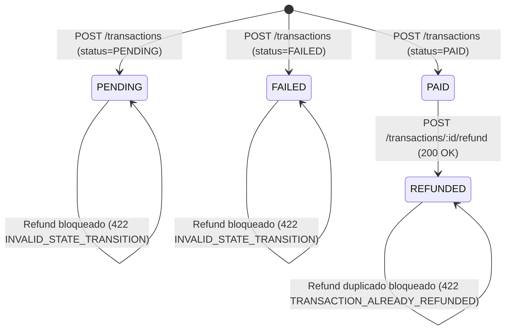

# Pulsar Payments Backend (`ppp-pulpay-backend`)

API REST do **Pulsar Payments**, um Hub de Pagamentos, Gestão de Carteiras e Conciliação com Webhooks desenvolvido com finalidade didática para o **Trabalho Final da Mentoria 2.0 (Turma 5) — Júlio de Lima**.

O projeto foi desenhado aplicando boas práticas de Engenharia de Software e **Testabilidade (Design for Testability)**, utilizando **persistência local em arquivo JSON (`data/database.json`)** sem dependência de bancos de dados externos ou containers. Isso garante inicialização imediata, reprodutibilidade determinística de cenários e execução ágil de testes unitários, testes de contrato e automação de API (QA).

---

## Sumário

1. [Stack Tecnológica](#1-stack-tecnológica)
2. [Arquitetura em Camadas e Testabilidade](#2-arquitetura-em-camadas-e-testabilidade)
3. [Requisitos, Regras de Negócio e Máquina de Estados](#3-requisitos-regras-de-negócio-e-máquina-de-estados)
4. [Padrões de Resposta e Contratos de Erro HTTP](#4-padrões-de-resposta-e-contratos-de-erro-http)
5. [Estratégia e Heurísticas de Teste (Mentoria 2.0)](#5-estratégia-e-heurísticas-de-teste-mentoria-20)
6. [Instalação, Execução e Testes](#6-instalação-execução-e-testes)
7. [Exemplos de Fluxo de Uso (cURL)](#7-exemplos-de-fluxo-de-uso-curl)

---

## 1. Stack Tecnológica

- **Runtime:** Node.js v18+ (ES Modules nativo com `"type": "module"`)
- **Framework HTTP:** `express`
- **Persistência Local:** Arquivo JSON (`data/database.json`) manipulado com módulos nativos (`node:fs`, `node:path`, `node:crypto`)
- **Autenticação & Criptografia:**
  - `bcryptjs` para hashing seguro de senhas (salt factor `10`)
  - `jsonwebtoken` para autenticação stateless via Bearer Token JWT
  - `node:crypto` para geração de UUIDs v4 e assinatura criptográfica **HMAC SHA-256** (`X-Signature`) em Webhooks
- **Documentação & Contrato de API:** OpenAPI 3.0 (`src/docs/swagger.yaml`) servida via `swagger-ui-express` (`/api-docs` e `/api-docs.json`)
- **Testes Automatizados:** Executor nativo `node:test` + `node:assert/strict` com cobertura de código superior a **98%**

---

## 2. Arquitetura em Camadas e Testabilidade

A separação de responsabilidades segue o padrão de camadas (**Routes → Controllers → Services → Models → Persistence**), isolando as regras financeiras da camada HTTP para favorecer tanto testes unitários de caixa-branca quanto testes integrados de caixa-preta:

```text
ppp-pulpay-backend/
├── data/
│   └── database.json                   # Persistência local JSON (merchants, accounts, transactions, webhooks)
├── src/
│   ├── config/
│   │   ├── database.js                 # Motor de leitura/escrita JSON, normalização e loader nativo de .env
│   │   └── swagger.js                  # Carregamento do swagger.yaml e exposição do Swagger UI (/api-docs)
│   ├── controllers/
│   │   ├── authController.js           # Registro e autenticação de lojistas (Merchants)
│   │   ├── accountController.js        # Criação e consulta de contas/carteiras
│   │   ├── transactionController.js    # Processamento de transações, listagem, consulta e estorno (refund)
│   │   └── webhookController.js        # Cadastro, listagem e simulação de webhooks assinados
│   ├── middlewares/
│   │   ├── authMiddleware.js           # Validação do header Authorization: Bearer <token>
│   │   └── errorHandler.js             # Classe AppError e padronização centralizada de erros HTTP
│   ├── models/
│   │   ├── Merchant.js                 # Entidade de lojista com omissão automática de senha (toJSON)
│   │   ├── Account.js                  # Entidade de conta/carteira em BRL com arredondamento decimal
│   │   ├── Transaction.js              # Entidade de transação financeira e controle de idempotência
│   │   └── Webhook.js                  # Entidade de webhook e histórico de entregas (deliveryLogs)
│   ├── routes/
│   │   ├── authRoutes.js               # Rotas públicas /auth
│   │   ├── accountRoutes.js            # Rotas autenticadas /accounts
│   │   ├── transactionRoutes.js        # Rotas autenticadas /transactions
│   │   └── webhookRoutes.js            # Rotas autenticadas /webhooks
│   ├── services/
│   │   ├── authService.js              # Regras de credenciais, unicidade de e-mail e emissão de JWT
│   │   ├── accountService.js           # Regras de moeda BRL e trava de saldo inicial negativo
│   │   ├── transactionService.js       # Motor financeiro, idempotência e máquina de estados de estorno
│   │   └── webhookService.js           # Validação de URL, assinatura HMAC SHA-256 e disparo de eventos
│   ├── docs/
│   │   └── swagger.yaml                # Especificação OpenAPI 3.0 com exemplos e scripts para Postman
│   ├── app.js                          # Configuração da aplicação Express, middlewares e rotas
│   └── server.js                       # Ponto de entrada e inicialização do servidor HTTP
├── tests/
│   └── unit/                           # Suíte de testes unitários isolados por camada (56 testes)
├── .env.example
├── LICENSE
├── package.json
└── README.md
```

---

## 3. Requisitos, Regras de Negócio e Máquina de Estados

### 3.1 Requisitos Funcionais (RF)

| Código | Domínio | Descrição | Endpoint(s) |
| :--- | :--- | :--- | :--- |
| **RF01** | Autenticação | Permitir o registro de lojistas (`Merchant`) e autenticação via e-mail e senha com emissão de token Bearer JWT. | `POST /auth/register`<br>`POST /auth/login` |
| **RF02** | Carteiras | Permitir criar contas financeiras em `BRL`, listar carteiras do lojista autenticado e consultar saldo por ID. | `POST /accounts`<br>`GET /accounts`<br>`GET /accounts/:id` |
| **RF03** | Transações | Processar cobranças (`CHARGE`, `CREDIT`) e pagamentos (`PAYMENT`, `DEBIT`), filtrar histórico e realizar estornos (`REFUND`). | `POST /transactions`<br>`GET /transactions`<br>`GET /transactions/:id`<br>`POST /transactions/:id/refund` |
| **RF04** | Webhooks | Permitir cadastrar URLs de notificação, consultar logs de entrega (`deliveryLogs`) e simular disparos assinados via HMAC SHA-256. | `POST /webhooks`<br>`GET /webhooks`<br>`POST /webhooks/test` |

### 3.2 Regras de Negócio Financeiras (RN)

- **RN01 — Segurança de Credenciais e Isolamento Multi-Tenant:**
  - Senhas devem ter no mínimo **6 caracteres** (`400 WEAK_PASSWORD`), são criptografadas com `bcryptjs` e **nunca** retornam nos payloads JSON.
  - E-mails são normalizados (`lowercase`/`trim`) e únicos por lojista (`409 EMAIL_ALREADY_EXISTS`).
  - Um lojista autenticado acessa exclusivamente suas próprias contas, transações e webhooks (`404` caso pertença a outro lojista).
- **RN02 — Moeda Exclusiva e Trava de Saldo Negativo:**
  - Todas as carteiras operam exclusivamente em **`BRL`** (`422 UNSUPPORTED_CURRENCY`).
  - Nenhuma conta pode ser aberta com `initialBalance < 0` (`422 NEGATIVE_BALANCE_NOT_ALLOWED`) nem sofrer débitos ou estornos que resultem em `balance < 0` (`422 INSUFFICIENT_FUNDS` / `422 INSUFFICIENT_FUNDS_FOR_REFUND`).
  - Contas com status diferente de `ACTIVE` (ex.: `BLOCKED`) não permitem movimentações (`422 ACCOUNT_BLOCKED`).
- **RN03 — Impacto Financeiro por Tipo e Status de Transação:**
  - O valor da transação (`amount`) deve ser estritamente maior que zero (`422 INVALID_TRANSACTION_AMOUNT`).
  - Apenas transações com status **`PAID`** sensibilizam o saldo da conta:
    - `CHARGE` / `CREDIT` + `PAID` → **Soma** ao saldo da conta.
    - `PAYMENT` / `DEBIT` + `PAID` → **Subtrai** do saldo da conta (desde que haja saldo suficiente).
  - Transações criadas com status `PENDING` ou `FAILED` são registradas, mas mantêm o saldo inalterado.
- **RN04 — Idempotência de Transações (`Idempotency-Key`):**
  - O envio do header `Idempotency-Key` em `POST /transactions` garante processamento único por lojista.
  - Requisições repetidas com a mesma chave retornam **`200 OK`** com `idempotentReplayed: true` e a transação original, sem duplicar créditos, débitos ou disparos de webhook.
- **RN05 — Máquina de Estados de Estorno (`/refund`) e Webhooks HMAC:**
  - Não é permitido criar uma transação diretamente como `REFUNDED` (`422 INVALID_INITIAL_STATUS`).
  - **Apenas** transações com status `PAID` podem transitar para `REFUNDED`.
  - Tentar estornar uma transação `PENDING` ou `FAILED` retorna `422 INVALID_STATE_TRANSITION`; tentar estornar uma transação já `REFUNDED` retorna `422 TRANSACTION_ALREADY_REFUNDED`.
  - Todo evento liquidado, falhado, estornado ou simulado gera um cabeçalho `X-Signature: sha256=<hex_digest>` calculado via HMAC SHA-256 sobre o payload do evento.



### 3.3 Requisitos Não Funcionais (RNF)

- **RNF01 — Desempenho:** Tempo de resposta esperado inferior a `500ms` no endpoint `/health` e inferior a `1000ms` nas operações transacionais locais.
- **RNF02 — Padronização de Contrato:** Respostas sempre em `application/json` documentadas em OpenAPI 3.0 (`/api-docs`).
- **RNF03 — Portabilidade Zero-Config:** Execução local sem necessidade de banco externo, utilizando arquivo JSON configurável via variável `DB_FILE`.
- **RNF04 — Qualidade de Código:** Cobertura de testes unitários superior a **98%** nas camadas da aplicação.

---

## 4. Padrões de Resposta e Contratos de Erro HTTP

Todos os erros tratados pelo middleware centralizado (`src/middlewares/errorHandler.js`) retornam uma estrutura JSON determinística para facilitar asserções em testes automatizados:

```json
{
  "error": "ERROR_CODE",
  "message": "Mensagem descritiva e determinística do motivo da falha"
}
```

| Status HTTP | Código (`error`) | Cenário de Disparo |
| :---: | :--- | :--- |
| `200 OK` | — | Login, listagens, consultas por ID, replay idempotente (`idempotentReplayed: true`), estorno e simulação de webhook. |
| `201 Created` | — | Criação de lojista (`/auth/register`), conta (`/accounts`), nova transação (`/transactions`) ou webhook (`/webhooks`). |
| `400 Bad Request` | `VALIDATION_ERROR`<br>`WEAK_PASSWORD`<br>`INVALID_BALANCE`<br>`MISSING_ACCOUNT_ID`<br>`INVALID_AMOUNT`<br>`INVALID_TRANSACTION_TYPE`<br>`INVALID_TRANSACTION_STATUS`<br>`INVALID_WEBHOOK_URL`<br>`INVALID_JSON` | Campos obrigatórios ausentes, senha com menos de 6 caracteres, tipos/formatos inválidos ou JSON malformado. |
| `401 Unauthorized` | `UNAUTHORIZED`<br>`INVALID_CREDENTIALS` | Header `Authorization: Bearer <token>` ausente/inválido/expirado ou credenciais incorretas no login. |
| `404 Not Found` | `ACCOUNT_NOT_FOUND`<br>`TRANSACTION_NOT_FOUND`<br>`WEBHOOK_NOT_FOUND`<br>`NOT_FOUND` | Recurso inexistente, pertencente a outro lojista ou rota HTTP não mapeada. |
| `409 Conflict` | `EMAIL_ALREADY_EXISTS` | Tentativa de registrar um lojista com e-mail já cadastrado. |
| `422 Unprocessable Entity` | `NEGATIVE_BALANCE_NOT_ALLOWED`<br>`UNSUPPORTED_CURRENCY`<br>`INVALID_TRANSACTION_AMOUNT`<br>`INVALID_INITIAL_STATUS`<br>`ACCOUNT_BLOCKED`<br>`INSUFFICIENT_FUNDS`<br>`INVALID_STATE_TRANSITION`<br>`TRANSACTION_ALREADY_REFUNDED`<br>`INSUFFICIENT_FUNDS_FOR_REFUND` | Violação de regra de negócio financeira, saldo insuficiente ou transição inválida na máquina de estados. |
| `500 Internal Server Error` | `INTERNAL_SERVER_ERROR` | Falha interna inesperada não mapeada como erro operacional. |

---

## 5. Estratégia e Heurísticas de Teste (Mentoria 2.0)

Este repositório foi estruturado para exercitar as principais técnicas de design de testes estudadas na **Mentoria 2.0**:

1. **Particionamento de Equivalência:**
   - Moedas válidas (`BRL`) vs. inválidas (`USD`, `EUR`).
   - Tipos de transação de entrada (`CHARGE`, `CREDIT`), saída (`PAYMENT`, `DEBIT`) e tipos inexistentes.
   - Protocolos de URL de webhook válidos (`http://`, `https://`) vs. inválidos (`ftp://`, strings sem protocolo).
2. **Análise de Valor Limite (Boundary Value Analysis):**
   - Comprimento de senha no registro: `5` caracteres (`400 WEAK_PASSWORD`) vs. `6` caracteres (`201 Created`).
   - Saldo inicial na criação de conta: `-0.01` (`422`), `0.00` (`201`) e `0.01` (`201`).
   - Valor de transação (`amount`): `0.00` (`422`), `0.01` (`201`), valor igual ao saldo disponível (`201`, saldo final `0.00`) e valor `0.01` acima do saldo disponível (`422 INSUFFICIENT_FUNDS`).
3. **Teste de Transição de Estados:**
   - Validação de todos os caminhos permitidos e bloqueados no ciclo de vida da transação (`PENDING`, `PAID`, `FAILED`, `REFUNDED`).
4. **Teste de Idempotência e Confiabilidade:**
   - Reenvio de payloads com a mesma `Idempotency-Key` verificando manutenção do saldo e código `200 OK`.
5. **Teste de Segurança e Isolamento:**
   - Tentativa de acesso sem JWT, com JWT adulterado ou tentando acessar recursos (`accountId`, `transactionId`, `webhookId`) de outro lojista.
   - Verificação do formato criptográfico `^sha256=[a-f0-9]{64}$` no header `X-Signature`.

---

## 6. Instalação, Execução e Testes

### Pré-requisitos
- **Node.js** `v18+` (não requer banco de dados externo nem Docker)

### Passo a passo

1. Instale as dependências:
   ```bash
   npm install
   ```

2. (Opcional) Crie o arquivo `.env` a partir do modelo `.env.example`:
   ```bash
   cp .env.example .env
   ```
   Variáveis suportadas:
   ```env
   PORT=3000
   DB_FILE=data/database.json
   JWT_SECRET=pulsar_super_secret_jwt_key_2026
   JWT_EXPIRES_IN=1d
   WEBHOOK_SECRET=whsec_pulsar_hmac_secret_2026
   ```

3. Inicie o servidor HTTP:
   - **Modo Desenvolvimento (com hot-reload ignorando `data/`):**
     ```bash
     npm run dev
     ```
   - **Modo Produção:**
     ```bash
     npm start
     ```

4. Acesse a documentação interativa **Swagger UI (OpenAPI 3.0)**:
   - Interface visual: `http://localhost:3000/api-docs`
   - Especificação JSON (pronta para importação no Postman): `http://localhost:3000/api-docs.json` ou arquivo `src/docs/swagger.yaml`

5. Execute a suíte de **Testes Unitários e Relatório de Cobertura**:
   ```bash
   # Executa as 22 suítes e 56 testes unitários
   npm test

   # Executa os testes exibindo a tabela de cobertura de linhas, branches e funções (> 98%)
   npm run test:coverage
   ```

> **Isolamento de Dados nos Testes:** A suíte unitária utiliza arquivos temporários dedicados (`data/test-database-*.json`) que são removidos automaticamente ao término da execução, preservando intacto o arquivo principal `data/database.json`.

---

## 7. Exemplos de Fluxo de Uso (cURL)

### 7.1 Registrar um Lojista (`POST /auth/register`)
```bash
curl -X POST http://localhost:3000/auth/register \
  -H "Content-Type: application/json" \
  -d '{
    "name": "Pulsar Store LTDA",
    "email": "qa@pulsarstore.com.br",
    "password": "Password@123",
    "document": "12.345.678/0001-99"
  }'
```

### 7.2 Autenticar e Obter o Token JWT (`POST /auth/login`)
```bash
curl -X POST http://localhost:3000/auth/login \
  -H "Content-Type: application/json" \
  -d '{
    "email": "qa@pulsarstore.com.br",
    "password": "Password@123"
  }'
```

### 7.3 Criar uma Conta / Carteira (`POST /accounts`)
```bash
curl -X POST http://localhost:3000/accounts \
  -H "Authorization: Bearer <SEU_TOKEN_JWT>" \
  -H "Content-Type: application/json" \
  -d '{
    "name": "Carteira Operacional",
    "initialBalance": 500.00,
    "currency": "BRL"
  }'
```

### 7.4 Criar uma Transação com Idempotência (`POST /transactions`)
```bash
curl -X POST http://localhost:3000/transactions \
  -H "Authorization: Bearer <SEU_TOKEN_JWT>" \
  -H "Idempotency-Key: idem-order-1001" \
  -H "Content-Type: application/json" \
  -d '{
    "accountId": "<ID_DA_CONTA>",
    "type": "CHARGE",
    "amount": 150.00,
    "status": "PAID",
    "description": "Venda PIX #1001"
  }'
```

### 7.5 Solicitar Estorno (`POST /transactions/:id/refund`)
```bash
curl -X POST http://localhost:3000/transactions/<ID_DA_TRANSACAO>/refund \
  -H "Authorization: Bearer <SEU_TOKEN_JWT>" \
  -H "Content-Type: application/json" \
  -d '{
    "reason": "Solicitação de cancelamento pelo comprador"
  }'
```

### 7.6 Cadastrar e Simular Webhook Assinado (`POST /webhooks` e `POST /webhooks/test`)
```bash
# Cadastrar Webhook
curl -X POST http://localhost:3000/webhooks \
  -H "Authorization: Bearer <SEU_TOKEN_JWT>" \
  -H "Content-Type: application/json" \
  -d '{
    "url": "https://meusistema.com.br/webhooks/pulsar",
    "events": ["transaction.paid", "transaction.failed", "transaction.refunded", "webhook.test"]
  }'

# Simular Disparo Assinado (X-Signature: sha256=...)
curl -X POST http://localhost:3000/webhooks/test \
  -H "Authorization: Bearer <SEU_TOKEN_JWT>" \
  -H "Content-Type: application/json" \
  -d '{
    "event": "webhook.test",
    "data": { "orderId": "1001", "status": "PAID" }
  }'
```

---

## Licença

Distribuído sob a licença **MIT**. Consulte o arquivo [LICENSE](LICENSE) para mais informações.
